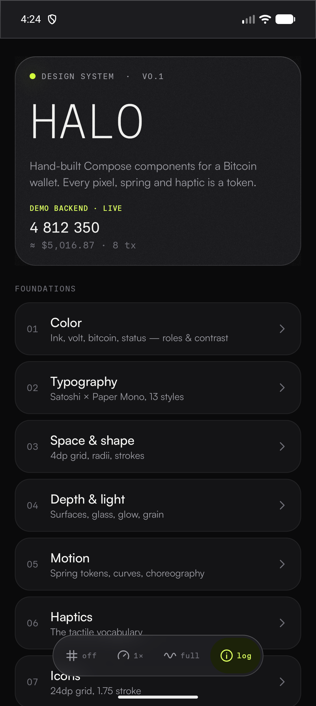
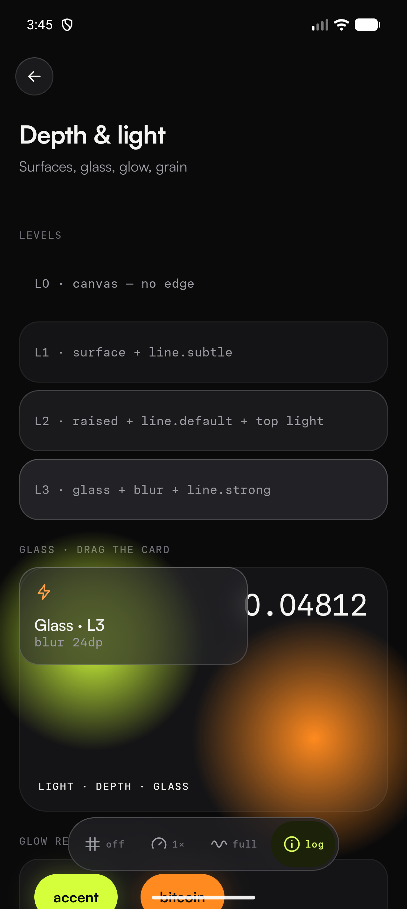
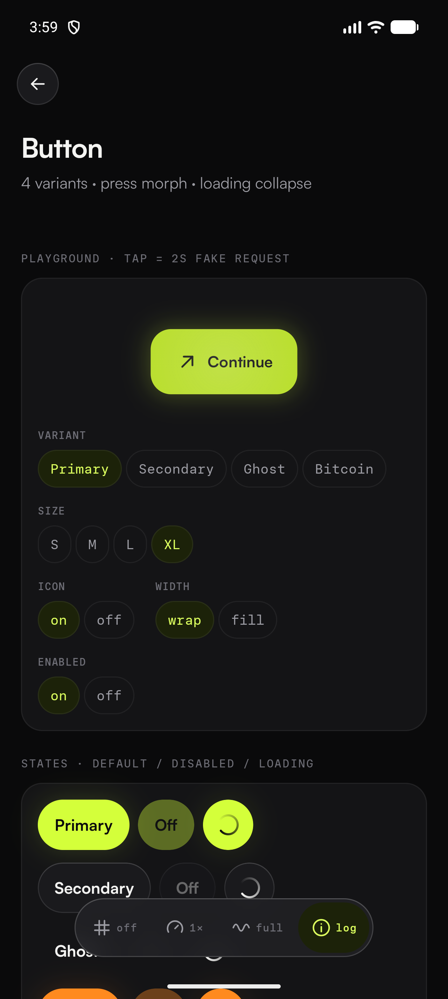
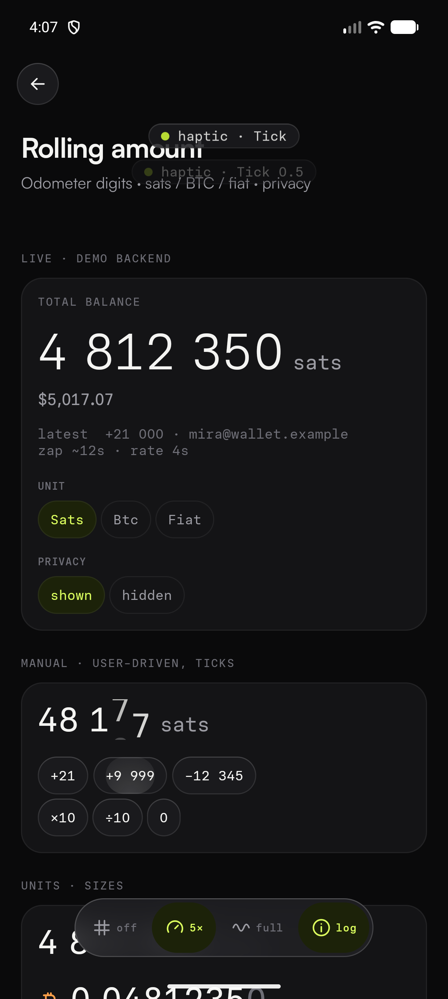
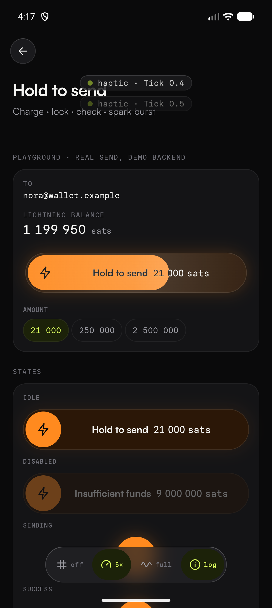
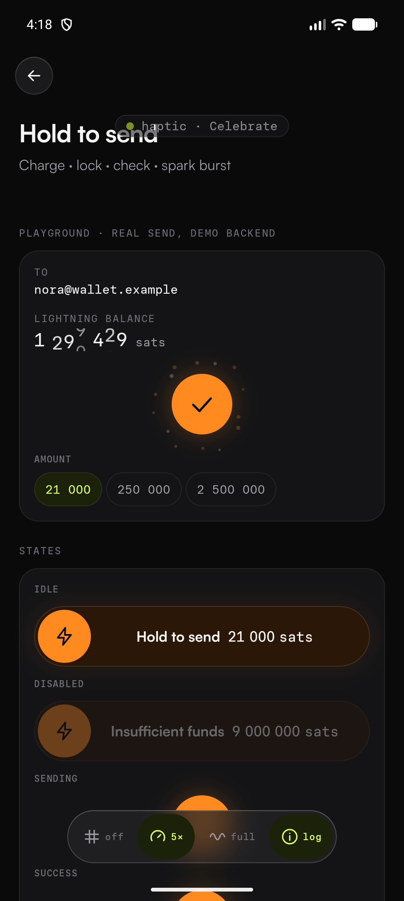

# Halo

A showcase Bitcoin wallet for native Android, built to demonstrate **AI-designed, hand-built UI**:
- a custom Jetpack Compose design system
- physically based motion
- a tactile haptic vocabulary
- pixel-exact components

Each component is produced by a Claude Code skill (`/halo-component`) from a written requirement.

The UI runs against a fake backend that behaves like a live one, sitting behind production architecture
(clean modules, Hilt, UDF, type-safe navigation). To connect a real backend, you replace one data module.

| Showroom | Glass & light | Button: pressed |
|---|---|---|
|  |  |  |

| Odometer mid-roll (5× slow-mo) | Hold to send: charging | Hold to send: success |
|---|---|---|
|  |  |  |

## Design system: Halo v0.1
- **Type:** *Satoshi* for UI and body text. *Paper Mono* for every number, amount, address and label.
- **Color:** dark-first ink neutrals. **Electric lime** is the single UI accent; **Bitcoin orange** is reserved for Bitcoin/Lightning meaning.
- **Depth from light, not shadow:** tone steps, hairlines, a top-edge light catch, glow and hand-built backdrop blur (no third-party libraries).
- **Motion:** six spring tokens (Snap, Quick, Standard, Expressive, Gentle, Digit). Everything is interruptible and animates in the draw/layout phase.
- **Haptics:** nine tokens (Tap, Tick, Toggle, Threshold, Confirm, Reject, Crescendo, Celebrate), built on platform constants and vibration compositions.
- **Native Android:**
  - edge-to-edge
  - predictive back
  - splash screen API
  - themed icon
  - TalkBack semantics on every component
  - reduced-motion support

Token reference: [`.claude/skills/halo-component/references/tokens.md`](.claude/skills/halo-component/references/tokens.md)

## Components
| Component | Archetype | Highlights |
|---|---|---|
| `HaloButton` | Pressable | press corner-morph, touch-origin light, loading collapse into a comet spinner |
| `HaloRollingAmount` | Value display | per-digit odometer (direction-aware springs), sats / BTC / fiat, privacy mask |
| `HaloHoldToSend` | Gesture-commit | 1.2s charge with rising haptics, clip-inverted label, lock → check draw-on → spark burst |

Registry: [`docs/components/REGISTRY.md`](docs/components/REGISTRY.md). Each component has a spec in `docs/components/`.

## Architecture
```
:app ──► :feature:showroom ──► :core:domain ──► :core:model
  └────► :core:data ─────────► :core:domain        (Fake* repositories today → Remote* tomorrow)
:feature:* ──► :core:designsystem                  (pure UI, no domain dependency)
build-logic/convention                             (Gradle convention plugins)
```
- **Domain:** repository interfaces plus use cases (`ObserveWalletOverview`, `SendPayment`, `ParsePaymentDestination`). Pure Kotlin and unit-tested.
- **Data:** `FakeWalletRepository` simulates latency, typed failures and incoming Lightning payments, so animations have live data. `FakeRatesRepository` ticks a price feed.
- **Presentation:** a `@HiltViewModel` exposes one `StateFlow<UiState>` plus `onAction`, and stateless screens render design-system components.
- **Connect a backend:** implement `WalletRepository` / `RatesRepository` in `:core:data` and change the bindings in `DataModule`.

## Build
Requirements: Android Studio 2026.2+ (JBR 21), SDK 37, minSdk 33.
Works on Windows, macOS and Linux. The simplest path is to open the project in Android Studio and run `app`.
From a terminal, use the bundled helper (Python 3.9+, standard library only). It finds Android Studio's JDK and
your Android SDK by itself:
```bash
python3 -I .claude/skills/halo-component/scripts/halo.py doctor                        # show the discovered JDK / SDK
python3 -I .claude/skills/halo-component/scripts/halo.py gradle :app:assembleDebug     # build
python3 -I .claude/skills/halo-component/scripts/halo.py gradle :core:domain:test      # unit tests
python3 -I .claude/skills/halo-component/scripts/lint_ds.py                            # design-system lint
python3 -I .claude/skills/halo-component/scripts/halo.py shot hold-to-send             # build, install, screenshot a page
```
On Windows, use `python` instead of `python3`. You can also call the Gradle wrapper directly (`./gradlew` or
`gradlew.bat`) once `JAVA_HOME` points to a JDK 21+.
Open any Showroom page by deep link: `adb shell am start -d "halo://showroom/hold-to-send" com.halo.wallet`.
Add `?slowmo=5&grid=8` to review motion and alignment.

## The component skill
`.claude/skills/halo-component/` turns a requirement into the six-artifact contract:
1. spec
2. component + previews
3. Showroom page
4. catalog entry
5. registry row
6. a verified device screenshot

It enforces tokens through a lint and reviews screenshots against pixel-perfect and archetype checklists.
In Claude Code:
```
/halo-component HaloAmountKeypad: a numeric keypad for entering sats with tick haptics and a shake on invalid input
```

## Roadmap
- **Next:** [Proposal 0001](docs/proposals/0001-material-surface-stack.md), a layered material surface stack (texture, lighting and edge as independent layers) with a shared scene light.
- **Wave 2 components:** amount keypad, unit toggle, transaction list, bottom sheet, address field, switch, QR, balance hero card.
- **Wallet screens:** Home, Send, Receive, Activity, Settings, with a light theme after.

Fonts: Paper Mono (SIL OFL 1.1) and Satoshi (ITF Free Font License, Fontshare).
